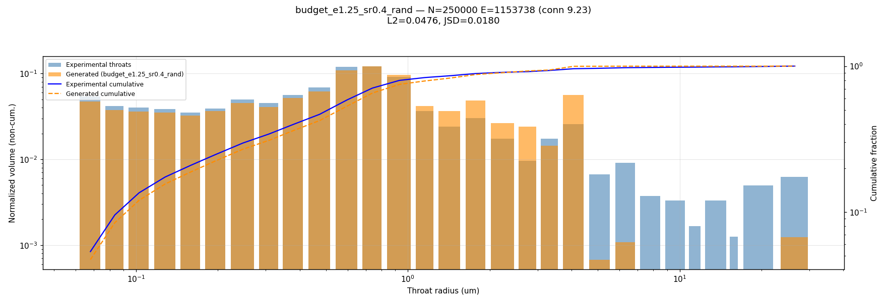
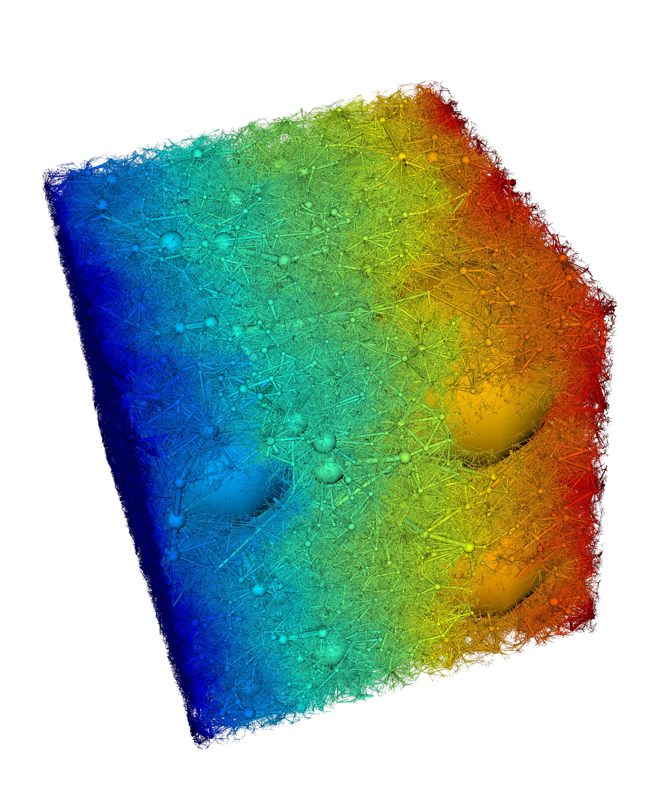

# PNM — Simple Pore Network Model

Python package for generating random pore networks **fitted to experimental mercury porosimetry (MIP) data** and simulating transport on them: steady-state molecular diffusion (Fick + Knudsen) and mercury intrusion.

- Author: Jerome Lux (`jerome.lux@univ-lr.fr`) — version 1.1
- Network format: **GML** (GEXF degrades set/list attributes; pickle is used only for internal caches)

<p align="center">
    
</p>

<p align="center"><em>Experimental (GM1) vs generated throat size distribution — `kernel_budget` inversion, e = 0.25 / sratio = 0.4, `order="random"`, seed 7; Jensen Shannon Divergence ≈ 0.018.</em></p>

<p align="center">
    
</p>

<p align="center"><em>Steady-state concentration field from a diffusion simulation (Fick + Knudsen, "conduit" throat model) between two opposite faces of the same 250k-pore network; average connectivity ⟨z⟩ ≈ 9.23.</em></p>

## Requirements & installation

Python ≥ 3.9 (developed on 3.12). Core dependencies: `numpy`, `scipy`, `networkx`, `scikit-learn`; `matplotlib` for plots, `vtk` for 3D visualization.

```bash# or your own environment
pip install -e .                                # from the project root
```

## Package layout

| Module | Contents |
|--------|----------|
| `pnm/PNM.py` | `pore_network` — graph-based network model (GML/GEXF/pickle I/O, geometry, categories) |
| `pnm/Generators.py` | `random_PNM`, **`fitted_random_PNM`**, `parallel_random_PNM`, kdtree packers |
| `pnm/Transformation.py` | throat generation (`add_throats_by_surf`, periodic throats), assembly, scaling |
| `pnm/Stats.py` | pore-distribution inversions, samplers, JSD / distribution I/O |
| `pnm/mip.py` | `MIPData`, `load_mip_data` — experimental MIP CSV loading/binning/filtering |
| `pnm/utils.py` | low-level geometry helpers (distances, nearest neighbors, radii sampling) |
| `pnm/Visualization.py` | `Fast3DViewer`, VTK viewers and actor helpers |
| `pnm/Algorithms/diffusion.py` | `molecular_diffusion` — steady-state diffusion solver |
| `pnm/Algorithms/percolation.py` | `mercury_intrusion` |

## Quickstart

### 1. Load the experimental MIP data

```python
from pnm import load_mip_data

# Full curve, or a radius window:
mip = load_mip_data("examples/data/GM1.csv", rmin=0.068, rmax=26.53)   # throat radii in µm
```

### 2. Generate one fitted network (single function call)

`fitted_random_PNM` runs the whole pipeline — inversion of the experimental throat distribution into a pore count distribution, kdtree packing at target porosity, and two-phase throat generation. **The defaults are the best "budget" recipe** (`kernel_budget`, e = 0.25 / sratio = 0.4, surf `order="random"`, JSD ≈ 0.01):

```python
from pnm import fitted_random_PNM

net = fitted_random_PNM(mip, npores=250_000, seed=7)   # budget recipe defaults
# other inversions: inversion="kernel" (e=0.75/sr=0.7), "kernel_gamma" (parameter-free, e ignored),
#                   "kernel_waterfill", "independent", or a callable
net.write("my_network", method="gml")                  # ".gml" is appended by write()
```

Useful options: `porosity` (default 0.35), `PRTRR` (2.0), `sratio`, `order`, `phase1_z`, `maxc`, and `pore_cache_path` — a pickle path that caches the packed pore set so re-runs skip packing (and stay bit-identical).

### 3. Batch generation (CLI)

One independent realization per seed, parallel workers, GML + gen-vs-exp plot per network:

```bash
python3 generate_networks.py --seeds 7,8,9,10 --npores 250000 --out-dir examples/networks
# recipe overrides: --inversion kernel --e 1.75 --sratio 0.7 --order decreasing ...
```

### 4. Steady-state diffusion (CLI)

Runs every matching network in x/y/z with Dirichlet BCs on the face pores and writes per-network CSVs + a summary:

```bash
python3 run_diffusion_all.py examples/networks \
    --pattern "2026*_asym5095_*" \
    --throat-model conduit \          # throat | effective | path | conduit | conduit_shared
    --directions x,y,z \
    --temperature 293 \               # K — used for the Knudsen diffusivity Dk = (1/6)·sqrt(8RT/(πMa))
    --save-concentrations             # also saves GML copies with concentration_x/y/z node attributes
```

Defaults match `examples/Simulation.ipynb`: Dinf = 1.25e-5 m²/s (CO₂ in air), Ma = 44 g/mol, T = 293 K, networks in µm (`--scale 1e-6`).

### 5. Diffusion solver

```python
from pnm import molecular_diffusion
import numpy as np

Dinf, Dk, scale = 1.25e-5, (1/6)*np.sqrt(8*8.3144*293/(np.pi*44e-3)), 1e-6   # µm networks
solver = molecular_diffusion(net)
solver.setup_throat_model(model="conduit")          # see below
solver.setup_diffusivity_model(model="All", d_fick=Dinf, d_knudsen=Dk, scale=1/scale)

hot  = net.get_pores_by_category(["x+"], mode="match_one")
cold = net.get_pores_by_category(["x-"], mode="match_one")
solver.add_bc(1.0, hot, bc_type="Dirichlet")
solver.add_bc(0.0, cold, bc_type="Dirichlet")
solver.setup_coef_matrix()
solver.solve(solver="cg", tol=1e-8)

q = solver.compute_boundary_flow(hot)
S, L = net.graph.graph["extent"][1]*net.graph.graph["extent"][2], net.graph.graph["extent"][0]
Deff = q * L * scale**2 / S                        # m²/s (BC 1→0 over length L)
```

Throat conductance models: `throat` (cylinder, gap-length — can overcount near-touching pairs), `path` (center-distance conductance), `conduit` (pore half–cylinder–pore half in series with per-segment Knudsen), `conduit_shared` (`--share area|uniform`; guarantees Deff/Dinf ≤ total void fraction).

## Pore-distribution inversions (`pnm/Stats.py`)

All take the experimental throat distribution `(volumes, midradii, deltaR)` and return `(cdist, pdist)`, where `pdist` is a pore **count** distribution (sums to 1):

| Function | Model | Free parameters |
|----------|-------|-----------------|
| `invert_pore_distribution_independent` | classical i.i.d. pairing, exact backward recurrence | e |
| `invert_pore_distribution_kernel` | spatial exclusion kernel from the generator's surface-budget mechanics | e |
| `invert_pore_distribution_kernel_budget` | kernel + budget-saturated size-dependent degree (count coupling only) | e |
| `invert_pore_distribution_kernel_waterfill` | kernel + joint per-class (count, composition) water-filling | e |
| `invert_pore_distribution_kernel_gamma` | parameter-free: step-1 capillary length derived from the kernel geometry (incomplete-gamma moments) | none |

Feed the result to the exact piecewise-uniform sampler with **full** pore bin edges (`mip.throat_radii * PRTRR`, i.e. n_bins + 1 values):

```python
from pnm import inverse_transform_sampling_from_raw_data
radii = inverse_transform_sampling_from_raw_data(pdist, bins=mip.throat_radii * 2.0, n_samples=N)
```

Full derivation of all five inversions — including the parameter-free gamma variant (§5.6): `doc/pore-distribution-inversion.pdf`.

## Recommended recipes (GM1 data)

| Recipe | Setup | Result |
|--------|-------|--------|
| **asym50_95 budget — default of `fitted_random_PNM`** | window = cumulative volume [50 %, 95 %] → [0.068, 26.53] µm; `kernel_budget` e=0.25/sr=0.4; surf order="random", phase1_z=0, p2f=2, maxc=1024 | JSD **0.0099** @ N=1.5e5 (near-exact large band) |


## Notes & gotchas

- **Never call `compute_geometry(autothroats=True)` after generation** — it erases all custom throat radii/lengths (resets every throat radius to `min(r1, r2)`). Always use `autothroats=False` (`random_PNM` already does).
- **Pass `PRTRR` explicitly at every call site**; pore bins are always `throat_radii * PRTRR`.
- `sratio` is the fraction of a pore's surface covered by throats — keep it in [0, 1] and pass the same value to the inversion and the generator (model/generator budgets must match).
- **Step-1 reparameterization (2026-11-25)**: the corrective exponent `e` now models the mean capillary length as `r**e` (`cdist ∝ v / (A·r**e)`, `e=0` = pure cross-section correction). Before that date it was `cdist ∝ v / A**e`; all historical e values shift by one (new = old − 1, e.g. the kernel recipe is now e=0.75, the budget default e=0.25). See `doc/pore-distribution-inversion.pdf` §2.
- Node `category` is a **set** of side labels (`x-, x+, y-, y+, z-, z+, inner, none`); GML round-trips restore it automatically.

## Documentation

- `doc/pore-distribution-inversion.pdf` — inversion theory (independent / kernel / budget / water-filling / parameter-free gamma)

## Credits

- **Author**: Jerome Lux (`jerome.lux@univ-lr.fr`)
- The documentation (this README and `doc/`) as well as the code optimization were carried out with the assistance of an AI coding agent.
